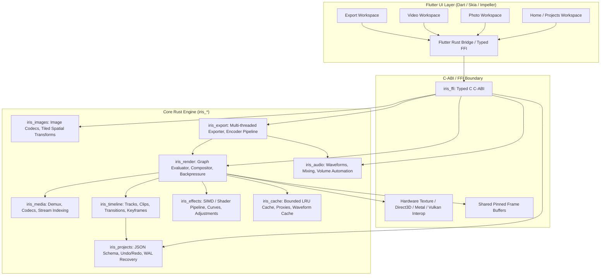

# Iris Studio: System Architecture Document

## 1. High-Level Architectural Overview

Iris Studio uses a hybrid Rust-Flutter architecture designed for maximal performance, safety, and cross-platform portability.

---

## 2. Crate Architecture & Boundary Responsibilities

The codebase is organized into decoupled, highly cohesive Rust crates located under `/crates`:

| Crate | Responsibility | Dependencies |
| :--- | :--- | :--- |
| `iris_core` | Foundational types: `RationalTime`, `TimeSpan`, `ColorSpace`, `PixelFormat`, `Rect`, `Point`, errors | None |
| `iris_media` | Media container demuxing, video stream parsing, PTS sorting, hardware decoder abstraction | `iris_core`, safe platform decoders |
| `iris_images` | Image encoding/decoding (JPEG, PNG, WebP), crop, rotate, flip, Lanczos3 resize, tiled processing | `iris_core`, `image`, `webp` |
| `iris_timeline` | Non-destructive timeline data model, tracks, clips, transitions, keyframes, rational timebases, edit operations | `iris_core`, `serde` |
| `iris_effects` | High-performance pixel processing: exposure, contrast, temperature, curves, levels, unsharp mask, blur, vignette, blend modes | `iris_core`, `rayon` (SIMD ready) |
| `iris_render` | Compositing engine, layer blending, preview renderer with backpressure, cancellation, double-buffering | `iris_core`, `iris_timeline`, `iris_effects`, `iris_media`, `iris_cache` |
| `iris_audio` | Audio decoding, resampling, track mixing, gain envelopes, waveform envelope peak generation | `iris_core` |
| `iris_projects` | Portable JSON project model, serialization/deserialization, undo/redo command stack, auto-save, WAL journal | `iris_core`, `iris_timeline`, `serde`, `serde_json` |
| `iris_cache` | Multi-tier bounded cache manager: memory LRU frame cache, disk thumbnail cache, disk proxy cache | `iris_core`, `lru` |
| `iris_export` | Export scheduler, frame rendering, video/audio encoding, batch image processor, output validation pass | `iris_core`, `iris_render`, `iris_images`, `iris_audio` |
| `iris_ffi` | C-ABI exported functions for Dart/Flutter interop, memory pinning, event callbacks | All crates |

---

## 3. UI-Engine Interoperability & Threading Model

### 3.1 Thread Separation
1. **Flutter UI Thread**: Runs the Dart event loop, widget layouts, gesture recognizers, and animation controllers. Strict rule: No media decoding, heavy image transforms, or disk I/O ever executes on this thread.
2. **Rust Worker Thread Pool**: Powered by Tokio / Rayon. Handles background decoding, timeline evaluation, waveform generation, and export rendering.
3. **Dedicated Render Thread**: Evaluates the compositing tree at the requested preview time `t`, outputs RGBA/BGRA frames into a double-buffered shared presentation target.

### 3.2 Presentation Mechanisms
- **Texture Interoperability (Phase 0 Proof)**:
  - Windows: Direct3D 11 / DXGI Shared Handle or BGRA pixel buffer pointer passed via FFI to Flutter's `Texture` widget.
  - Android: Vulkan / AHardwareBuffer or External Texture ID via JNI / NDK.
  - Software Fallback: Pinned RGBA byte buffer mapped into Flutter `dart:ffi` `Uint8List.view` rendered via Flutter `CustomPainter` / `ui.decodeImageFromPixels` ensuring 100% deterministic fallback across all platforms.

---

## 4. Memory Management & Cache Budgeting

To strictly adhere to the requirement that RAM usage must never scale with source video length or file size:
- **Frame Budget**: Default maximum RAM cache of 512 MB (user-configurable from 128 MB to 4 GB).
- **LRU Eviction**: Frames in memory are keyed by `(clip_id, frame_pts, resolution_tier)`. When the budget is reached, oldest accessed frames are purged immediately.
- **Tiled Processing for High-Res Photos**: Photos larger than 4096×4096 px are processed in 512×512 tiles, preventing multi-gigabyte memory spikes during continuous slider updates.
- **Garbage Collection**: Decoders release unreferenced GOP packets as the playhead moves past, maintaining bounded queue depths (typically 8-16 frames lookahead).

---

## 5. Non-Destructive Edit Graph & WAL Crash Recovery

1. **State as Data**: The timeline state is represented as a pure data structure `TimelineState`.
2. **Commands**: Every user edit (e.g. `SetExposure`, `TrimClip`, `SplitTrack`) is implemented as an explicit command with `apply()` and `invert()` methods.
3. **Write-Ahead Log (WAL)**:
   - When a command is dispatched, it is appended to an append-only WAL file on disk (`.iris-journal`) in atomic fashion.
   - On normal exit or explicit save, the main project file is updated atomically and the WAL is cleared.
   - If the application is terminated abruptly (power loss, OS kill), Iris Studio detects the pending WAL upon next launch and restores the exact session.
